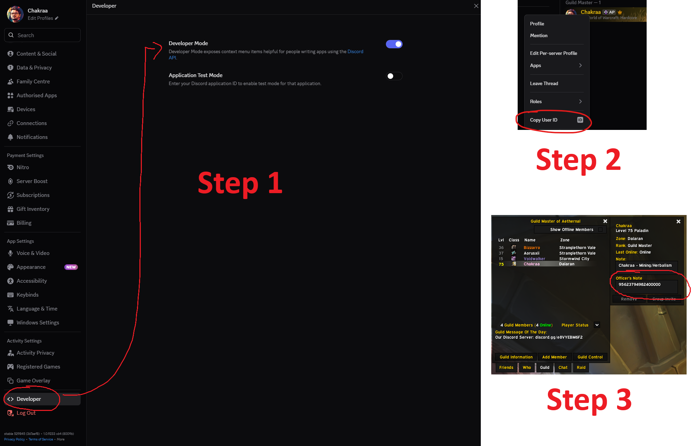

# WoWChat-Discord-Bot
A Discord bot that connects your World of Warcraft guild to your Discord server: guild chat goes both ways, and guild lists in Discord keep themselves up to date. Made mainly for 3.3.5 (Wrath of the Lich King) private servers.

Based on [WoWChat](https://github.com/fjaros/wowchat) by fjaros.

If you have any questions, add me on Discord: **Chakraa**

---

### Features
* Chat Relay: guild, officer and other in-game chats, mirrored to Discord channels and back
* Who's Online: a post that always shows who's online, with level, race, class and zone
* Guild Roster: every guild member grouped by Discord account, with guild stats and an officer checklist
* Role Sync: Discord roles follow in-game guild ranks
* Professions: members list their characters' professions so others can find a crafter
* Whisper Invite: players whisper the bot a word and get a guild invite
* Death Ping: mention a Discord role when a guild member dies
* Ignore and Ban lists, DM auto-reply, status rotation, and more

---

### Setup
1. Download the [latest version](https://github.com/ChakraaThePanda/WoWChat-Discord-Bot/archive/refs/heads/main.zip) and extract it somewhere.
2. Create your Discord bot in the [Discord Developer Portal](https://discord.com/developers/applications):
   * **New Application**, then in **Bot**, click **Reset Token** and copy it. On that page, also turn on **Presence Intent**, **Server Members Intent** and **Message Content Intent**.
   * In **OAuth2**, tick `bot` and `applications.commands`, then the **View Channels**, **Send Messages**, **Embed Links** and **Read Message History** permissions (and **Manage Roles** if you'll use role sync). Open the link it gives you to invite the bot to your server.
3. In WoW, make an account and a character for the bot, and invite that character to your guild.
4. Open `bot/wowchat.conf` and replace each `FILL_ME_IN`: the bot token, your server's realmlist, realm name, the bot's account, password and character, and the ID of the Discord channel for guild chat (turn on Developer Mode in Discord, then right-click the channel and click **Copy Channel ID**).
5. Double-click `bot/Start WoWChat.bat`.

The first start installs Java if it's missing (a Windows permission popup may appear). If that fails, install [Java](https://adoptium.net/) yourself and start it again.

Everything else in `wowchat.conf` is optional and explained right in the file. Features are off until you turn them on.

---

### Running the bot
The bot runs in the background, with its logo in the system tray next to the clock. Right-click the logo to **Show log**, **Restart bot** or **Stop bot and exit**. A red dot on the logo means the bot stopped; open the log to see why.

If the bot loses its connection to WoW or Discord, it restarts itself.

* **Start with Windows**: press `Win + R`, type `shell:startup`, and put a shortcut to `Start WoWChat.bat` in that folder.
* **Run in a window instead**: from a terminal in the `bot` folder, run `"Start WoWChat.bat" console`.

#### Updating
Extract the new version to a new folder, then copy `wowchat.conf` and the `data` folder from your old `bot` folder into the new one. This keeps your settings, professions, and ignore and ban lists.

Coming from an older version that started with `run.bat`? Do the same, then start the bot with `Start WoWChat.bat` instead, and update your Windows startup shortcut if you had one.

---

### In Discord
Type `/menu` to open the bot's menu, or `/help` for a quick overview. Only you see the menu.
* **Who's Online**: who's playing right now, with level, class and zone.
* **Look Up Player**: level, class, zone and guild rank of any player.
* **Professions**: add or remove your characters' professions, or **Find Crafters** for one.
* **Ignore & Ban Lists**: see who the bot ignores or keeps out of the guild.
* **Admin Actions** (for the server owner and the admin roles you pick in `wowchat.conf`): promote, demote, ignore, unignore, ban and unban.

Most views have **Post to channel** to share them with everyone.

#### Link your characters
Linking your characters to your Discord account shows your Discord name next to them in the guild panels, and lets you set their professions. Each member does this for their own characters:
1. In Discord, turn on Developer Mode: **User Settings → Advanced → Developer Mode**.
2. Right-click your name anywhere in Discord and click **Copy User ID**.
3. In WoW, open the Guild panel and paste your User ID in your character's **Officer Note** (ask an officer) or **Public Note**, whichever your guild uses.

The bot picks it up within a few minutes.

